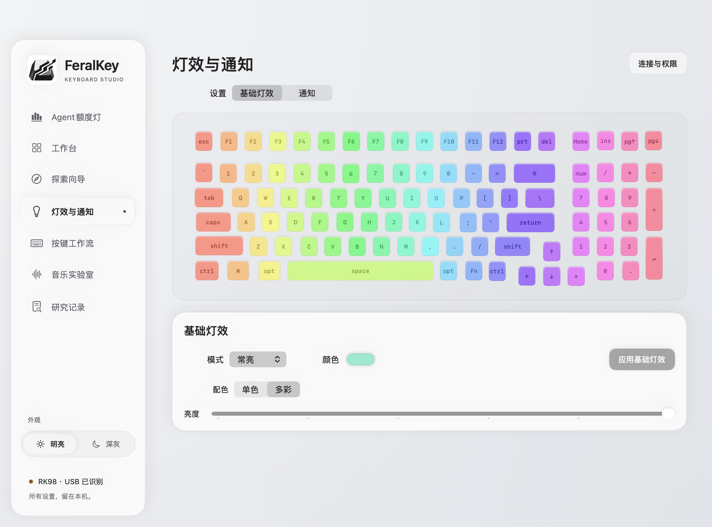
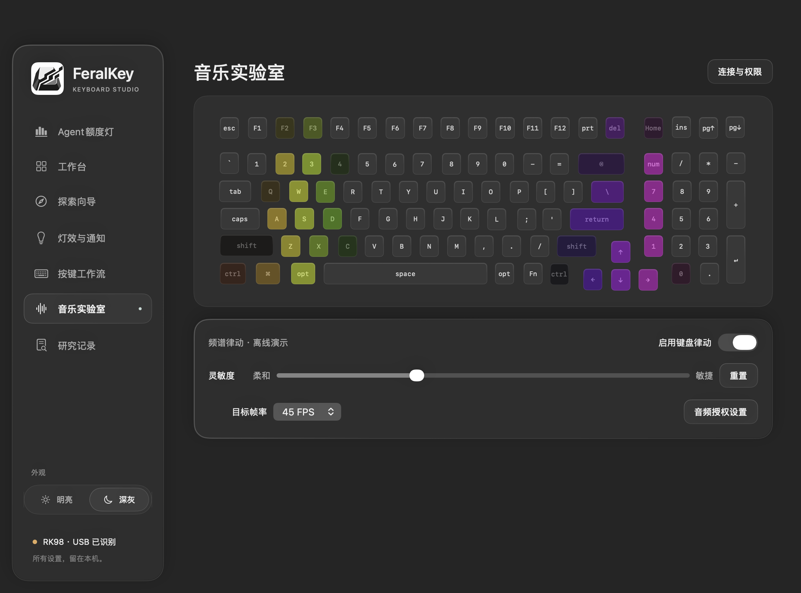
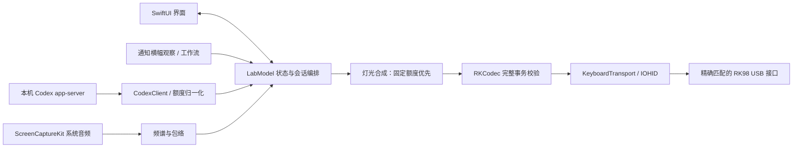

<p align="center"></p>
<h1 align="center">FeralKey</h1>
<p align="center">让键盘灯光成为工作状态的一部分。</p>
<p align="center">macOS 原生键盘灯光与工作流实验工具 · 当前实验适配 RK98 有线版本</p>
<p align="center">
  <a href="LICENSE"></a>
  
  
  
</p>
<p align="center"><a href="#兼容性">兼容性</a> · <a href="#快速开始">快速开始</a> · <a href="#技术架构">技术架构</a> · <a href="#二次开发">二次开发</a> · <a href="docs/README.md">完整文档</a></p>

FeralKey 把 Codex 五小时与每周剩余额度显示成两条键盘灯，结合分区通知、多彩基础灯效、系统音频律动和组合键映射，为键盘增加可自定义的工作状态反馈。界面使用 SwiftUI，提供明亮与深灰两套玻璃风格主题。

**当前只实现 RK98-100KRGB N（USB `258A:00C1`）的实验控制适配，不是全品牌通用驱动。** 同为 RK98 的不同批次也可能采用不同协议。2.4G、蓝牙及其他品牌目前不能使用实体灯光控制；设备识别、电量读取、离线测试通过均不代表灯控已适配。

## 界面预览

| 明亮 · 多彩基础灯效 | 深灰 · 音乐实验室 |
| --- | --- |
|  |  |

截图来自 0.10 的应用界面预览；音乐图为离线演示，不代表实体键盘的刷新率或显示效果。

## 功能

| 功能 | 当前实现 |
| --- | --- |
| **Agent 额度灯** | Codex 五小时 / 每周双进度条；独立开关、十个百分比槽、自定义键位和颜色；固定额度区优先于其他灯效 |
| **自动更新** | 默认每分钟更新屏幕额度，可选 30 秒、1 / 3 / 5 / 10 / 30 分钟；实体自动同步需用户开启 |
| **基础灯效** | 单色 / 多彩、常亮、渐变、呼吸、跑马灯、代码雨；配置后点击应用 |
| **分区通知** | 自选通知键位、预设图案或自由绘制；显示 5 秒后恢复，静态图案呼吸；系统横幅检测为实验功能 |
| **音乐实验室** | 手动启停，跟随系统播放声音；24 段频谱、灵敏度和目标帧率调节；默认 45 FPS，可选最高 60 FPS |
| **按键与工作流** | 普通键与 ⌃⇧⌥⌘ 组合键映射、常用预设、专注计时，以及可选的全局快捷键与 macOS 快捷指令 |
| **设备探索** | 接口元数据扫描、研究包导出、无线只读诊断与适配教程，帮助开发者收集证据 |

实体功能受精确设备匹配与实验边界限制。音乐及分区动画使用实验实时通道，45 / 60 FPS 是软件调度目标，尚无自动化实物验证；微信等应用的横幅联动也需在目标系统人工验证。

## 兼容性

| 设备 / 连接 | 当前状态 |
| --- | --- |
| **RK98-100KRGB N · USB `258A:00C1`** | 唯一已实现的实验控制适配；有线接口已在开发机识别，编码与模型流程有离线测试；各项实物效果需按清单验证 |
| RK98 · 2.4G 接收器 `25A7:FA70` | 可识别及执行受限状态读取；**不支持灯控**，共享编号不能确定型号 |
| RK98 · 蓝牙 `RK98RGB 5.0` / `000E:3412` | 独立诊断可识别、读取标准电量；**不支持灯控**，不属于主应用控制后端 |
| 其他 RK 型号、批次及其他品牌 | 可探索接口信息，**尚无控制适配**；需要新增协议、布局和传输实现 |

有线写入还必须匹配 USB、Usage Page `1` / Usage `128`、65 字节 Feature Report 与 Report ID `0x0A`。外壳型号写 RK98，但当前匹配的公开布局包含 **100 个物理键位**。

应用最低部署目标为 **macOS 13**，构建需要 **macOS 26+ SDK**。目前只在 Apple Silicon 开发机检查过，Intel 和旧版系统尚未实测；macOS 26 使用原生 Liquid Glass 控件，旧系统使用材质回退。[完整兼容范围 →](docs/COMPATIBILITY.md)

## 快速开始

当前以源码研究预览版提供。仓库不包含可直接安装的正式签名、公证发行包。

### 构建

准备含 **macOS 26 或更新 SDK** 的 Xcode / Command Line Tools，以及 Python 3（运行仓库和打包检查）。下载并解压源码，或克隆仓库，在项目根目录执行：

```sh
./scripts/build.sh
open build/FeralKey.app
```

没有外部 Swift 包依赖，不需要安装 Node.js、Windows 或刷写固件。源码 ZIP 若未保留执行位，先执行 `chmod +x scripts/*.sh tests/fake-codex.py`。构建输出为当前 Mac 架构，不是通用二进制。

### 连接与权限

使用 USB 有线模式连接匹配的 RK98。通过「连接与权限」入口，在 macOS「隐私与安全性 → 输入监控」中添加本次构建的 `FeralKey.app`，完全退出后重新打开；进入探索向导阅读风险须知，再连接并应用一次基础灯效。

音乐需要系统音频录制权限；实验系统横幅检测需要辅助功能权限，按需开启。临时签名在重新构建后可能变化；已经授权仍出现 `0xe00002e2` 时，见[权限排查](docs/PERMISSIONS.md)。

### Agent 额度灯

安装可提供 `app-server` 的 Codex，并使用 ChatGPT 账号登录；也可在应用中选择已有的兼容 Codex 可执行文件。FeralKey 通过其标准输入输出请求 `account/rateLimits/read`，无需粘贴 API Key、Cookie 或令牌，也不创建模型对话。

选择五小时 / 每周的键位和颜色，应用配置后同步真实额度。屏幕默认自动更新，实体同步由用户开启；读数缺失、过期或失败时停止发送。键盘保留上次成功发送的快照，不会在应用退出后自动清空。[使用指南 →](docs/USER-GUIDE.md) · [额度接入细节 →](docs/CODEX-QUOTA.md)

## 技术架构



| 层 | 主要文件（位于 Sources） | 技术与职责 |
| --- | --- | --- |
| 界面 | `Main.swift`、`*Views.swift`、`Theme.swift` | SwiftUI / AppKit；页面、布局与明暗材质 |
| 状态编排 | `LabModel.swift` | ObservableObject / Combine；草稿与已应用状态、持久化、权限和连接代次 |
| 数据来源 | `CodexClient.swift`、`SystemAudio.swift`、`SystemNotifications.swift` | Codex 子进程通信、ScreenCaptureKit 音频、Accessibility 横幅观察 |
| 领域逻辑 | `Quota.swift`、`Lighting.swift`、`Features.swift` | 额度有效性、颜色合成、频谱与图案；可使用离线数据测试 |
| 协议与传输 | `Protocol.swift`、`HID.swift`、`Discovery.swift` | 报告编码、完整事务白名单、IOKit HID 访问与精确设备匹配 |

实时发送保持单帧在途，不积压旧帧；重连撤销旧回调。额度读取、颜色绘制和数据源可复用，设备协议与灯位映射仍需单独适配。[架构说明与数据流 →](docs/ARCHITECTURE.md)

## 二次开发

从[开发指南](docs/DEVELOPMENT.md)开始。新增灯光效果通常修改渲染与合成层；新增数据来源可复用颜色层；新增键盘则需同时提供精确匹配条件、布局、报告编码、传输能力和验证证据。

**当前没有通用设备插件加载器。** `docs/adapters/` 的 JSON 是协议证据清单，不能仅添加 VID/PID 就让新品牌使用 RK98 命令。适配流程见[探索自己的键盘](docs/KEYBOARD-GUIDE.md)及[贡献指南](CONTRIBUTING.md)。

```text
FeralKey/
├── Sources/          SwiftUI、领域逻辑与 macOS / HID 实现
├── Resources/        布局、键码、应用图标及第三方许可
├── scripts/          构建、打包、离线验证与只读诊断
├── tests/            模拟传输、本地夹具与打包回归
├── docs/             使用、架构、扩展及发布说明
│   ├── adapters/     设备匹配与协议来源清单
│   ├── assets/       应用界面预览
│   ├── research/     USB / 2.4G / 蓝牙研究记录
│   ├── history/      历次功能与验证记录
│   └── reviews/      历史代码审查及修复记录
└── .github/          自动检查、Issue 与 PR 模板
```

### 检查与测试

```sh
python3 scripts/check-repository.py  # 文档链接、提交文件与常见凭据检查
python3 tests/RepositoryChecksTests.py # 公开前检查的拒绝路径回归
./scripts/test.sh                   # 协议、额度、合成、客户端与模型检查
./scripts/test-auto-refresh.sh      # 自动刷新计时回归，使用本地假 Codex
./scripts/quota-smoke.sh            # 离线额度 → 颜色 → 完整报告，不发送 HID
python3 tests/PackagingTests.py     # 隔离副本构建 / 打包与排除规则检查
```

上述测试不需要真实账号或键盘，不能代替[实物验收](docs/TESTING.md)。GitHub Actions 配置为 macOS 上的离线检查及独立路径构建；上传后首次执行结果才是远程 CI 状态。

## 风险与隐私

请仅研究自己拥有或获得授权的设备，遵守适用法律；建议使用闲置或备用键盘。协议探索可能导致配置丢失、设备异常甚至损坏。本项目按现状提供，在适用法律允许范围内不对相关损失承担责任。

- **无法备份键盘原有配置**；导出的是软件配置和接口信息。改键会写入整套默认布局加修改，覆盖已有映射。
- 部分灯光是否写入内部存储仍未知；自动实体同步和实验实时通道均需明确开启。
- HID 控制不注册按键输入回调；音频分析不使用麦克风、不保存音频；横幅观察不读取消息正文。
- `evidence/` 和 `build/` 已忽略。账号文件、个人额度及抓包不应提交；常见凭据检查不替代人工审阅。

完整范围见[键盘探索教程](docs/KEYBOARD-GUIDE.md)与[安全说明](SECURITY.md)。

## 贡献与致谢

欢迎提交可复现问题、协议资料、离线测试和有明确验证记录的适配。请使用 Issue / PR 模板；报告不兼容同样有价值。[贡献指南 →](CONTRIBUTING.md) · [更新记录 →](CHANGELOG.md)

RK98 协议及布局基于 [Rangoli](https://github.com/rnayabed/rangoli)；界面材质参考 [Solid Glass](https://github.com/deeplethe/solid-glass)，设置交互参考 [FanBar](https://github.com/helson-lin/FanBar)。实时家族协议等资料的精确来源、许可与验证边界见 [THIRD_PARTY.md](THIRD_PARTY.md)。

本项目采用 **GPL-3.0-or-later**，见 [LICENSE](LICENSE)。FeralKey 是独立社区研究项目，与 RK、OpenAI 及其他被提及的品牌不存在官方合作或背书关系。
