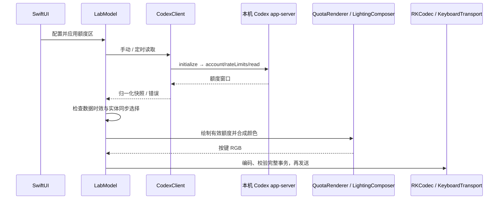

# 技术架构

FeralKey 是一个 Swift / SwiftUI macOS 原生应用，由脚本直接调用 `swiftc` 构建；没有 Electron、Node.js 运行时或外部 Swift 包依赖。`Sources/` 目前按职责划分文件，尚未拆成独立 Swift Package。以下描述实际实现，不代表已经存在通用硬件插件系统。

## 分层与入口

| 层 | 文件 | 职责 |
| --- | --- | --- |
| 应用与 UI | `Main.swift`、`QuotaViews.swift`、`LightingViews.swift`、`FeatureViews.swift`、`ConnectionViews.swift` | 应用入口、页面、键盘预览、确认及权限入口 |
| 主题 | `Theme.swift` | 明亮 / 深灰材质；SwiftUI 与 AppKit，按系统版本回退 |
| 会话与状态 | `LabModel.swift` | ObservableObject 发布状态；草稿与已应用配置、UserDefaults 持久化、任务与写入确认 |
| 额度 | `CodexClient.swift`、`Quota.swift` | 本机子进程通信、协议解析、窗口识别、时效性、百分比槽绘制 |
| 灯光与功能 | `Lighting.swift`、`Features.swift` | 多彩配色、动态图案、分区合成、音频频谱和包络、组合键预设 |
| 系统集成 | `SystemAudio.swift`、`SystemNotifications.swift`、`BannerTest.swift` | ScreenCaptureKit 音频、Accessibility 横幅元数据观察、应用自己的测试横幅 |
| 设备与协议 | `Discovery.swift`、`Protocol.swift`、`HID.swift` | 元数据扫描、布局及配置校验、报告编码、完整事务验证、受限 IOHID 传输 |
| 独立研究 | `BluetoothResearch.swift`、`Sources/Probe.swift`、`scripts/*Probe.swift` | 读取策略与只读诊断；不作为通用主应用控制后端 |

所有上述文件位于 `Sources/`，研究脚本除外。资源使用 `Resources/rk98-layout.json`、`keycodes.json` 等明确允许项载入；缺失或损坏时进入恢复界面，停止设备操作。

## 额度到键盘

`CodexClient` 启动短生命周期的 Codex `app-server --listen stdio://` 子进程，通过标准输入输出交换消息。它不读取账号凭据文件、不创建模型任务。五小时和每周按窗口时长识别，不假定 primary / secondary 的固定位置。错误、缺失、过期或跨重置时间的数据视为未知，不向实体发送；屏幕与实体同步分别控制。

## 灯光合成与发送

各数据源生成布局中的键位颜色，再由 `LightingComposer` 合成。已应用的固定 Agent 区优先；通知只暂时覆盖允许的键，默认五秒后恢复；其他键使用基础灯光或音乐。界面草稿不直接改变实体，应用成功后才保存该次可恢复的状态。

动态图案和音频使用目标帧率调度，默认 45 FPS，最高可选 60 FPS。HID 层维持单帧在途，忙时跳过机会而不是堆积旧帧。IO 锁、队列和发送代次避免事务交错；重连、关闭或失败会取消旧会话的回调与恢复任务。它们是软件侧控制，不能保证设备吞吐或无闪烁。

`RKCodec` 编码灯光或完整按键映射，并检查报告长度、包数、顺序、边界及命令白名单。`KeyboardHID` 只打开精确匹配的 USB 控制接口，整笔事务先验证再发送。`KeyboardTransport` 可注入模拟实现；新增设备应有独立编码及能力边界，不能复用 RK98 身份放行未知报文。

## 系统能力与隐私

- 系统音频由 ScreenCaptureKit 提供，分析 24 段频谱及包络，不用麦克风、不保存录音。
- 通知通过 Accessibility 观察横幅元数据，不读取消息正文；用户开启、权限有效且已应用基础灯效后才运行。
- 可选全局快捷键使用 macOS 事件能力，不通过原始 HID 输入回调收集打字内容。
- 偏好使用 UserDefaults，导入配置有大小和内容校验；保留历史 bundle ID 以兼容本地设置，临时签名仍可能改变权限身份。
- 无线只读研究和主应用 USB 写入相互隔离，不因诊断成功而授权 RGB 写入。

## 测试边界

协议、渲染、额度和模型使用本地夹具、可控时钟及模拟传输验证；自动刷新计时测试使用假 Codex。打包检查在隔离副本中构建，验证资源白名单、递归敏感文件排除和失败时保留旧应用。所有这些测试都不能替代实物验收。

扩展入口见[开发指南](DEVELOPMENT.md)，设备证据见[兼容范围](COMPATIBILITY.md)及 [RK98 清单](adapters/rk98-258a-00c1.json)。
